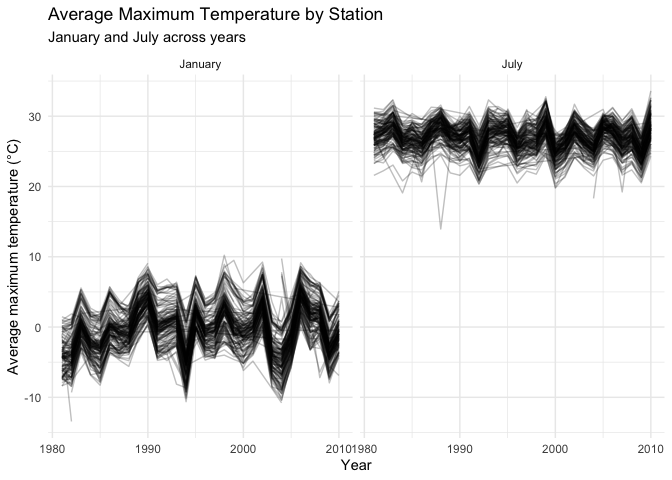
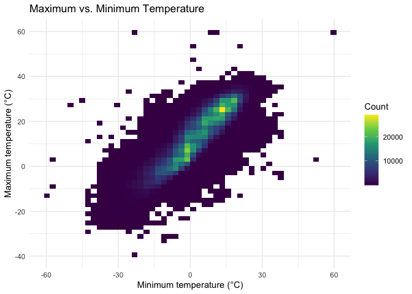
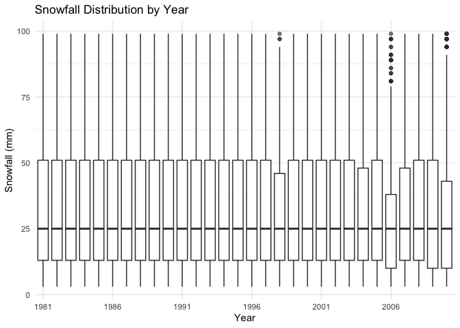
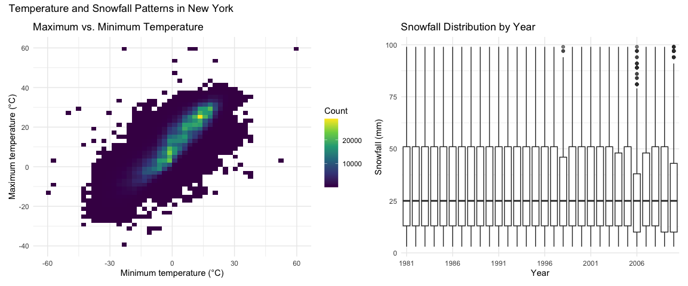

P8105 Homework 3
================
Rezwana Habib
2026-10-19

### Problem 1

``` r
# Load the New York NOAA weather dataset
data("ny_noaa")

ny_noaa
```

    ## # A tibble: 2,595,176 × 7
    ##    id          date        prcp  snow  snwd tmax  tmin 
    ##    <chr>       <date>     <int> <int> <int> <chr> <chr>
    ##  1 US1NYAB0001 2007-11-01    NA    NA    NA <NA>  <NA> 
    ##  2 US1NYAB0001 2007-11-02    NA    NA    NA <NA>  <NA> 
    ##  3 US1NYAB0001 2007-11-03    NA    NA    NA <NA>  <NA> 
    ##  4 US1NYAB0001 2007-11-04    NA    NA    NA <NA>  <NA> 
    ##  5 US1NYAB0001 2007-11-05    NA    NA    NA <NA>  <NA> 
    ##  6 US1NYAB0001 2007-11-06    NA    NA    NA <NA>  <NA> 
    ##  7 US1NYAB0001 2007-11-07    NA    NA    NA <NA>  <NA> 
    ##  8 US1NYAB0001 2007-11-08    NA    NA    NA <NA>  <NA> 
    ##  9 US1NYAB0001 2007-11-09    NA    NA    NA <NA>  <NA> 
    ## 10 US1NYAB0001 2007-11-10    NA    NA    NA <NA>  <NA> 
    ## # ℹ 2,595,166 more rows

``` r
# Check dataset size, structure, and missing values
dim(ny_noaa)
```

    ## [1] 2595176       7

``` r
glimpse(ny_noaa)
```

    ## Rows: 2,595,176
    ## Columns: 7
    ## $ id   <chr> "US1NYAB0001", "US1NYAB0001", "US1NYAB0001", "US1NYAB0001", "US1N…
    ## $ date <date> 2007-11-01, 2007-11-02, 2007-11-03, 2007-11-04, 2007-11-05, 2007…
    ## $ prcp <int> NA, NA, NA, NA, NA, NA, NA, NA, NA, NA, NA, NA, NA, NA, NA, NA, 3…
    ## $ snow <int> NA, NA, NA, NA, NA, NA, NA, NA, NA, NA, NA, NA, NA, NA, NA, NA, 3…
    ## $ snwd <int> NA, NA, NA, NA, NA, NA, NA, NA, NA, NA, NA, NA, NA, NA, NA, NA, 0…
    ## $ tmax <chr> NA, NA, NA, NA, NA, NA, NA, NA, NA, NA, NA, NA, NA, NA, NA, NA, N…
    ## $ tmin <chr> NA, NA, NA, NA, NA, NA, NA, NA, NA, NA, NA, NA, NA, NA, NA, NA, N…

``` r
ny_noaa |>
  summarize(
    missing_prcp = sum(is.na(prcp)),
    missing_snow = sum(is.na(snow)),
    missing_snwd = sum(is.na(snwd)),
    missing_tmax = sum(is.na(tmax)),
    missing_tmin = sum(is.na(tmin))
  )
```

    ## # A tibble: 1 × 5
    ##   missing_prcp missing_snow missing_snwd missing_tmax missing_tmin
    ##          <int>        <int>        <int>        <int>        <int>
    ## 1       145838       381221       591786      1134358      1134420

``` r
# Clean dates and weather measurements
noaa_clean =
  ny_noaa |>
  mutate(
    year = as.integer(format(date, "%Y")),
    month = as.integer(format(date, "%m")),
    day = as.integer(format(date, "%d")),
    prcp = prcp / 10,
    tmax = as.numeric(tmax) / 10,
    tmin = as.numeric(tmin) / 10
  )

noaa_clean
```

    ## # A tibble: 2,595,176 × 10
    ##    id          date        prcp  snow  snwd  tmax  tmin  year month   day
    ##    <chr>       <date>     <dbl> <int> <int> <dbl> <dbl> <int> <int> <int>
    ##  1 US1NYAB0001 2007-11-01    NA    NA    NA    NA    NA  2007    11     1
    ##  2 US1NYAB0001 2007-11-02    NA    NA    NA    NA    NA  2007    11     2
    ##  3 US1NYAB0001 2007-11-03    NA    NA    NA    NA    NA  2007    11     3
    ##  4 US1NYAB0001 2007-11-04    NA    NA    NA    NA    NA  2007    11     4
    ##  5 US1NYAB0001 2007-11-05    NA    NA    NA    NA    NA  2007    11     5
    ##  6 US1NYAB0001 2007-11-06    NA    NA    NA    NA    NA  2007    11     6
    ##  7 US1NYAB0001 2007-11-07    NA    NA    NA    NA    NA  2007    11     7
    ##  8 US1NYAB0001 2007-11-08    NA    NA    NA    NA    NA  2007    11     8
    ##  9 US1NYAB0001 2007-11-09    NA    NA    NA    NA    NA  2007    11     9
    ## 10 US1NYAB0001 2007-11-10    NA    NA    NA    NA    NA  2007    11    10
    ## # ℹ 2,595,166 more rows

``` r
# Check cleaned variables
noaa_clean |>
  select(date, year, month, day, prcp, snow, snwd, tmax, tmin) |>
  head()
```

    ## # A tibble: 6 × 9
    ##   date        year month   day  prcp  snow  snwd  tmax  tmin
    ##   <date>     <int> <int> <int> <dbl> <int> <int> <dbl> <dbl>
    ## 1 2007-11-01  2007    11     1    NA    NA    NA    NA    NA
    ## 2 2007-11-02  2007    11     2    NA    NA    NA    NA    NA
    ## 3 2007-11-03  2007    11     3    NA    NA    NA    NA    NA
    ## 4 2007-11-04  2007    11     4    NA    NA    NA    NA    NA
    ## 5 2007-11-05  2007    11     5    NA    NA    NA    NA    NA
    ## 6 2007-11-06  2007    11     6    NA    NA    NA    NA    NA

``` r
# Find the most common snowfall values
snowfall_frequency =
  noaa_clean |>
  filter(!is.na(snow)) |>
  count(snow, sort = TRUE)

snowfall_frequency |>
  slice_head(n = 10)
```

    ## # A tibble: 10 × 2
    ##     snow       n
    ##    <int>   <int>
    ##  1     0 2008508
    ##  2    25   31022
    ##  3    13   23095
    ##  4    51   18274
    ##  5    76   10173
    ##  6     8    9962
    ##  7     5    9748
    ##  8    38    9197
    ##  9     3    8790
    ## 10   102    6552

``` r
# Calculate percent missing for key weather variables
noaa_clean |>
  summarize(
    prcp_missing = mean(is.na(prcp)) * 100,
    snow_missing = mean(is.na(snow)) * 100,
    snwd_missing = mean(is.na(snwd)) * 100,
    tmax_missing = mean(is.na(tmax)) * 100,
    tmin_missing = mean(is.na(tmin)) * 100
  )
```

    ## # A tibble: 1 × 5
    ##   prcp_missing snow_missing snwd_missing tmax_missing tmin_missing
    ##          <dbl>        <dbl>        <dbl>        <dbl>        <dbl>
    ## 1         5.62         14.7         22.8         43.7         43.7

The original `ny_noaa` dataset contains 2,595,176 observations and 7
variables. Each row represents a daily weather observation for a station
identified by `id` and `date`. Key weather variables include
precipitation (`prcp`), snowfall (`snow`), snow depth (`snwd`), maximum
temperature (`tmax`), and minimum temperature (`tmin`). Missing data are
fairly common for some variables: about 5.6% of precipitation values,
14.7% of snowfall values, 22.8% of snow depth values, and 43.7% of
maximum temperature values are missing.

The most common snowfall value is 0 mm, with 2,008,508 observations.
Other common values include 25, 13, 51, and 76 mm. Zero is by far the
most common because most station-days do not have snowfall. The other
repeated values likely reflect common snowfall amounts originally
recorded in inches and converted to millimeters.

``` r
# Calculate average max temperature by station and year
jan_july_df =
  noaa_clean |>
  filter(month %in% c(1, 7)) |>
  mutate(
    month = factor(
      month,
      levels = c(1, 7),
      labels = c("January", "July")
    )
  ) |>
  group_by(id, year, month) |>
  summarize(
    mean_tmax = mean(tmax, na.rm = TRUE),
    .groups = "drop"
  ) |>
  filter(is.finite(mean_tmax))

jan_july_df
```

    ## # A tibble: 8,141 × 4
    ##    id           year month   mean_tmax
    ##    <chr>       <int> <fct>       <dbl>
    ##  1 USC00300023  1981 January     -3.17
    ##  2 USC00300023  1981 July        28.3 
    ##  3 USC00300023  1982 January     -4.32
    ##  4 USC00300023  1982 July        27.8 
    ##  5 USC00300023  1983 January      1.11
    ##  6 USC00300023  1983 July        29.8 
    ##  7 USC00300023  1984 July        27.2 
    ##  8 USC00300023  1985 January     -1.30
    ##  9 USC00300023  1989 July        27.1 
    ## 10 USC00300023  1990 January      4.92
    ## # ℹ 8,131 more rows

``` r
# Plot average max temperature in January and July
jan_july_df |>
  ggplot(
    aes(
      x = year,
      y = mean_tmax,
      group = id
    )
  ) +
  geom_line(alpha = 0.25) +
  facet_wrap(~month, nrow = 1) +
  labs(
    title = "Average Maximum Temperature by Station",
    subtitle = "January and July across years",
    x = "Year",
    y = "Average maximum temperature (°C)"
  ) +
  theme_minimal()
```

<!-- -->

``` r
# Show the relationship between maximum and minimum temperature
temp_plot =
  noaa_clean |>
  filter(
    !is.na(tmax),
    !is.na(tmin)
  ) |>
  ggplot(aes(x = tmin, y = tmax)) +
  geom_bin_2d(bins = 50) +
  scale_fill_viridis_c() +
  labs(
    title = "Maximum vs. Minimum Temperature",
    x = "Minimum temperature (°C)",
    y = "Maximum temperature (°C)",
    fill = "Count"
  ) +
  theme_minimal()

temp_plot
```

<!-- -->
Average maximum temperatures are much lower in January than in July
across stations. Both months show noticeable year-to-year variation, but
there is no strong long-term pattern that is obvious across the full
period. Most station averages cluster fairly closely together, although
there are a few unusually low station-year averages in both January and
July that stand out from the rest.

``` r
# Show snowfall distributions by year
snow_plot =
  noaa_clean |>
  filter(
    snow > 0,
    snow < 100
  ) |>
  ggplot(aes(x = factor(year), y = snow)) +
  geom_boxplot(outlier.alpha = 0.2) +
  scale_x_discrete(
    breaks = as.character(seq(1981, 2010, by = 5))
  ) +
  labs(
    title = "Snowfall Distribution by Year",
    x = "Year",
    y = "Snowfall (mm)"
  ) +
  theme_minimal()

snow_plot
```

<!-- -->

``` r
# Combine temperature and snowfall plots
temp_plot + snow_plot +
  plot_layout(ncol = 2) +
  plot_annotation(
    title = "Temperature and Snowfall Patterns in New York"
  )
```

<!-- -->
Maximum and minimum temperatures have a strong positive relationship,
with most observations concentrated along a clear upward pattern. There
are also a small number of unusually extreme temperature observations
outside the main concentration. Snowfall distributions are fairly
similar across years, with most nonzero snowfall measurements
concentrated at lower values. Some years have more high snowfall
observations near the upper end of the restricted range, but there is
not a clear long-term shift in the overall distribution.

# Problem 2

# Problem 3
